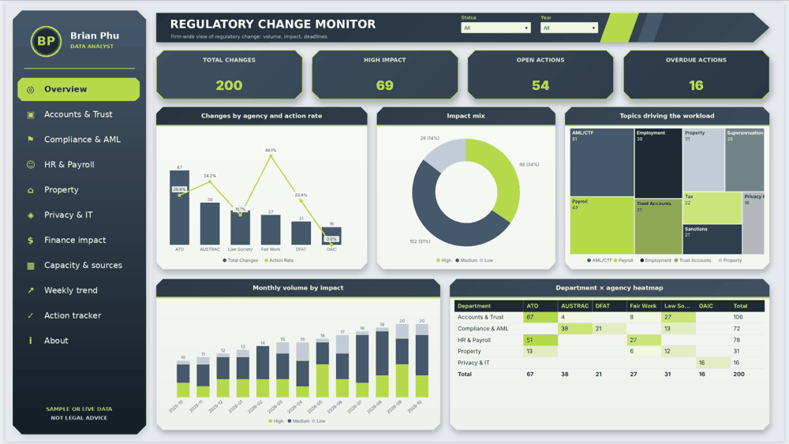
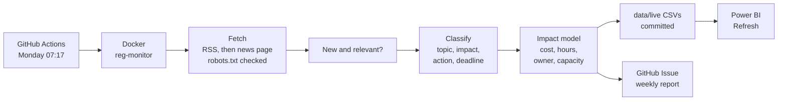
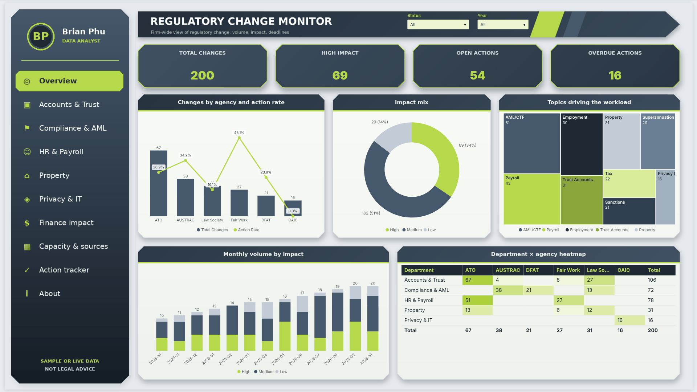
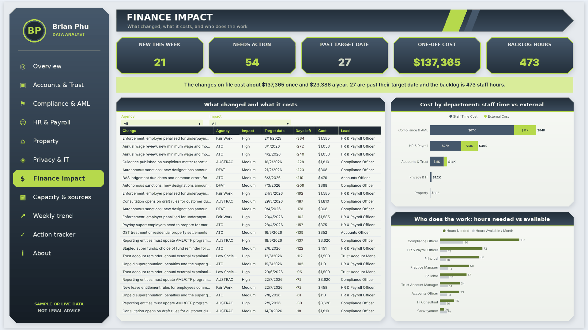
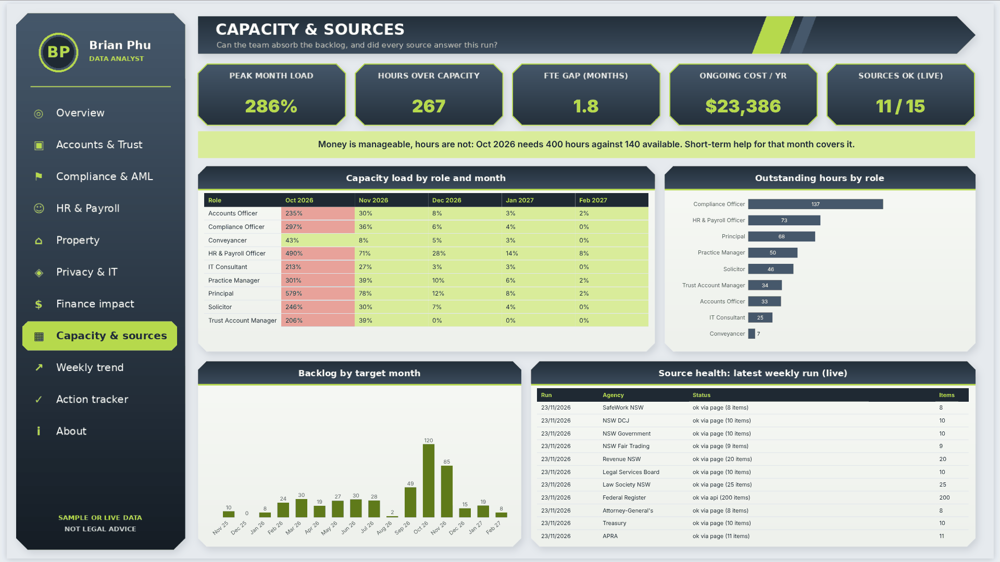
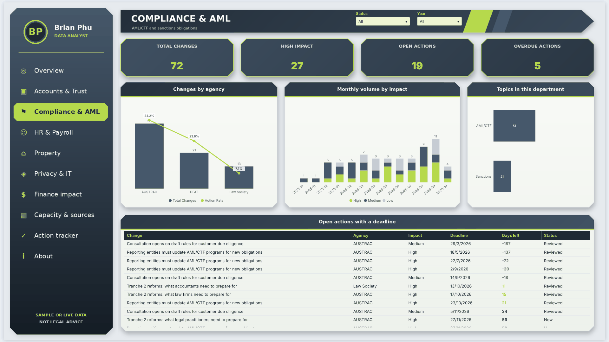
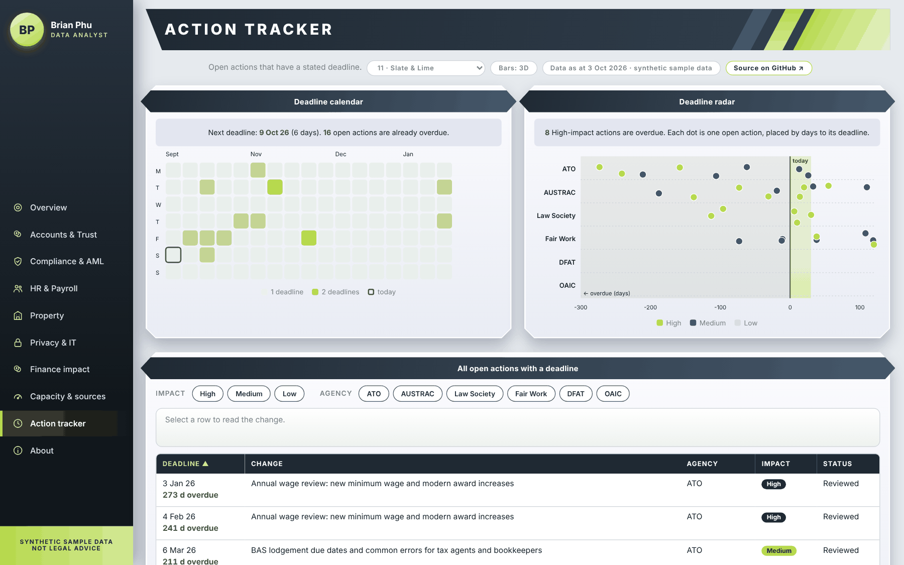

# Regulatory Change Monitor

[](https://github.com/brianphu2310/Regulartory_Change_Monitor/actions/workflows/ci.yml)
[](https://github.com/brianphu2310/Regulartory_Change_Monitor/actions/workflows/monitor.yml)

Every Monday morning this project reads official Australian agency news, keeps what matters to a law firm, estimates
what each change will **cost**, how much **time** is left and **who** has to do the work, opens a report as a GitHub
Issue, and feeds a Power BI dashboard. Nobody has to open a browser.

**[▶ Open the live dashboard](https://brianphu2310.github.io/Regulartory_Change_Monitor/)** (no sign-in, works on phone) · [Power BI report](powerbi/README.md) · [Impact model](docs/IMPACT_MODEL.md) · [Live monitor](docs/LIVE_MONITOR.md)

[](https://brianphu2310.github.io/Regulartory_Change_Monitor/)

*The live link is the web version of the dashboard: same pages, same data and the same Slate & Lime design, drawn with D3 so anyone
can open it without a Power BI licence. The Power BI report itself is in [`powerbi/`](powerbi/) (screenshot below).*

## At a glance

| | |
|---|---|
| **Question** | Which regulatory changes matter to a law firm, what will they cost, and does the team have the hours to deal with them? |
| **What I built** | A weekly pipeline (Docker on GitHub Actions) that fetches agency news, de-duplicates, classifies with transparent rules, costs each change with an impact model, commits the results and raises a GitHub Issue; a 10-page Power BI report on top that switches between sample and live data with one parameter. |
| **Key results** | On the synthetic year: **$137K** one-off cost ($104K staff time, $33K external), **$23K a year** ongoing, **473 outstanding hours**, 27 changes past target. October needs **400 hours against 140 available**, mostly the Compliance Officer and the Principal: the money is manageable, the people are not. |
| **Live proof** | 35 candidate sources probed from the cloud; 15 in the monitor, 11 of them reachable from GitHub. First full run (21 Nov 2026): 321 real items fetched, 29 relevant kept, 7 needing action. Blocked sources are logged, not worked around ([docs/SOURCES.md](docs/SOURCES.md)). |
| **Tech** | Python, pandas, requests, BeautifulSoup, feedparser · Docker · GitHub Actions · Power BI (TMDL + PBIR project, DAX, Power Query M) · pytest |
| **Honest limits** | Tags and costs come from stated rules and assumptions, not legal advice or quotes. Several agency sites refuse cloud runners; those need a desktop run. The v1 report uses synthetic data. |

## How it works



Design decisions, trade-offs and what I would change at scale: [docs/ARCHITECTURE.md](docs/ARCHITECTURE.md).

## Three versions, one repo

| Version | Adds | Read more |
|---|---|---|
| **v1** Report | Rule-based classifier, star schema, 12-page Power BI report by department, synthetic year of 200 changes | [POWERBI_GUIDE.md](POWERBI_GUIDE.md) |
| **v2** Impact model | Cost (staff time × loaded rate + external), target dates, owner role, monthly capacity by role | [docs/IMPACT_MODEL.md](docs/IMPACT_MODEL.md) |
| **v3** Live monitor | Weekly fetch from real agency sites, Docker, GitHub Actions, GitHub Issue reports; the Power BI report rebuilt as code (PBIP) with Finance impact and Capacity & sources pages | [docs/LIVE_MONITOR.md](docs/LIVE_MONITOR.md), [powerbi/](powerbi/) |

## Dashboard

**`powerbi/RegulatoryChangeMonitor.pbip`**: open in Power BI Desktop and press **Refresh**. It reads the CSVs from this repo over HTTPS; the `Dataset` parameter switches between the synthetic year (`bi_export`) and the weekly monitor (`data/live`). [How to open it](powerbi/README.md).

| Pages | What they answer |
|---|---|
| Overview, Accounts & Trust, Compliance & AML, HR & Payroll, Property, Privacy & IT | Which changes affect which part of the firm, how urgent they are |
| **Finance impact** (new) | What changed, what it costs (staff time vs external), who does the work |
| **Capacity & sources** (new) | Load by role and month, backlog by target month, which sources answered the last run |
| Action tracker, About, plus drill-through and tooltip pages | Open actions by deadline; method and limits |

The original v1 file is kept as [`regulatory_change_monitor.pbix`](https://github.com/brianphu2310/Regulartory_Change_Monitor/raw/main/powerbi/regulatory_change_monitor.pbix); the [web dashboard](https://brianphu2310.github.io/Regulartory_Change_Monitor/) opens without Power BI (source: [`preview/`](preview/), data refreshed by `python preview/build_preview.py`).

## Screenshots

<table>
<tr><td width="50%"><a href="docs/powerbi/regulatory-1-overview.png"></a><br><sub>Power BI report: Overview</sub></td><td width="50%"><a href="docs/preview/1_overview.png"></a><br><sub>Web dashboard: Overview</sub></td></tr>
<tr><td><a href="docs/preview/3_finance.png"></a><br><sub>Finance impact: what it costs and who does the work</sub></td><td><a href="docs/preview/4_capacity.png"></a><br><sub>Capacity & sources: load by role and month, live source health</sub></td></tr>
<tr><td><a href="docs/preview/2_compliance.png"></a><br><sub>Compliance & AML department page</sub></td><td><a href="docs/preview/5_tracker.png"></a><br><sub>Action tracker: deadline calendar and radar</sub></td></tr>
</table>

## Repo map

| Path | What it is |
|---|---|
| `monitor/` | Live pipeline: sources, polite fetching, run orchestration and report |
| `classifier.py` | Rule-based tagging: topic, impact, audience, action required, deadline |
| `impact_model.py` | Cost, hours, owner and capacity of each change; every assumption in one place |
| `Dockerfile`, `run_local.ps1` | The monitor as a container, in the cloud or on a desktop |
| `.github/workflows/monitor.yml` | Weekly run: build, fetch, commit, open the issue |
| `data/live/`, `reports/` | Output of the live runs (created by the first run) |
| `bi_export/` | Synthetic star schema and impact tables (sample data for both reports) |
| `powerbi/` | The report as a PBIP project (generated by `build_pbip.py`) and the original v1 `.pbix` |
| `generate_synthetic.py`, `db.py`, `export_for_bi.py` | Synthetic data, SQLite storage, CSV export |
| `preview/` | Web version of the dashboard (single HTML file, D3), published on GitHub Pages |
| `app.py` | Small Streamlit explorer over the synthetic data |
| `docs/` | Architecture, impact model, live monitor, data dictionary, skills map |

## Run it

```bash
pip install -r requirements-dev.txt
python -m pytest -q                  # 39 tests: rules, impact model, fetcher (offline), Power BI project
python -m monitor.run --dry-run      # fetch and print, write nothing
python -m monitor.run                # one full run: data/live/ and reports/latest.md
python impact_model.py               # rebuild the impact tables on the sample data
python powerbi/build_pbip.py         # regenerate the Power BI project (PBIP)
```

Or the same run in Docker: `docker build -t reg-monitor . && docker run --rm -v "$PWD/data:/app/data" -v "$PWD/reports:/app/reports" reg-monitor`.

## Tests and CI

`python -m pytest -q` runs 39 tests: classifier rules (including real Treasury titles), consistency of the star schema,
the impact model's totals (effort adds up, cost = internal + external, capacity balances), the fetcher offline
(RSS and page parsing, robots.txt respected, a failing source does not stop the run, baseline then no duplicates), and
the Power BI project (every field any of the 14 pages uses exists in the model, every model column exists in the CSV, every sidebar links all ten pages). CI runs them on every push.
