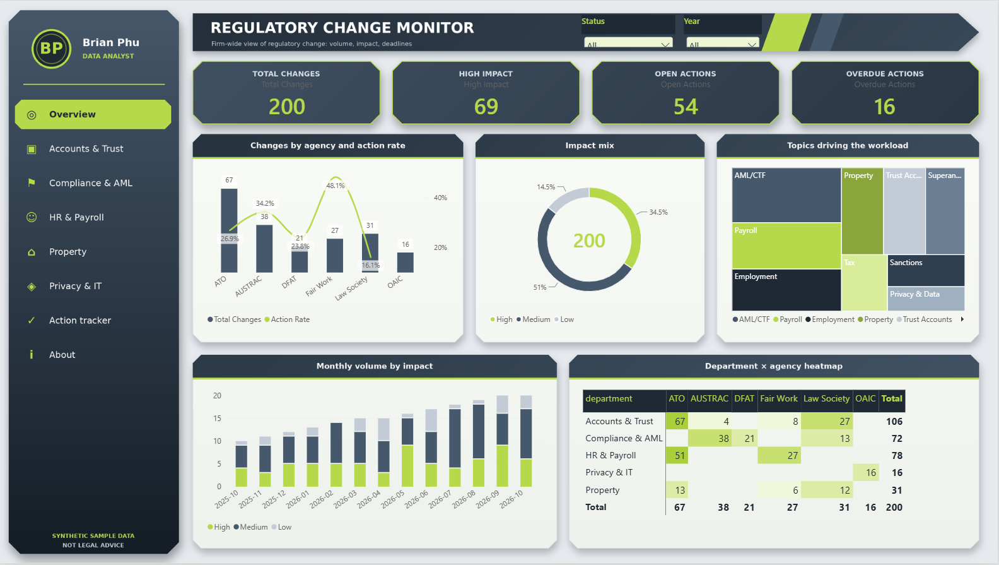
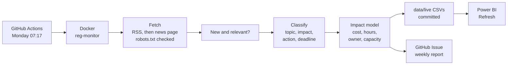

# Regulatory Change Monitor

[](https://github.com/brianphu2310/Regulartory_Change_Monitor/actions/workflows/ci.yml)
[](https://github.com/brianphu2310/Regulartory_Change_Monitor/actions/workflows/monitor.yml)

Every Monday morning this project reads official Australian agency news, keeps what matters to a law firm, estimates
what each change will **cost**, how much **time** is left and **who** has to do the work, opens a report as a GitHub
Issue, and feeds a Power BI dashboard. Nobody has to open a browser.



## At a glance

| | |
|---|---|
| **Question** | Which regulatory changes matter to a law firm, what will they cost, and does the team have the hours to deal with them? |
| **What I built** | A weekly pipeline (Docker on GitHub Actions) that fetches agency news, de-duplicates, classifies with transparent rules, costs each change with an impact model, commits the results and raises a GitHub Issue; two Power BI reports on top. |
| **Key results** | On the synthetic year: **$137K** one-off cost ($104K staff time, $33K external), **$23K a year** ongoing, **473 outstanding hours**, 27 changes past target. October needs **400 hours against 140 available**, mostly the Compliance Officer and the Principal: the money is manageable, the people are not. |
| **Live proof** | First cloud run on 20 Nov 2026 fetched 10 real Treasury consultations; blocked sources are logged, not worked around. |
| **Tech** | Python, pandas, requests, BeautifulSoup, feedparser · Docker · GitHub Actions · Power BI (TMDL + PBIR project, DAX, Power Query M) · pytest |
| **Honest limits** | Tags and costs come from stated rules and assumptions, not legal advice or quotes. Several agency sites refuse cloud runners; those need a desktop run. The v1 report uses synthetic data. |

## How it works



Design decisions, trade-offs and what I would change at scale: [docs/ARCHITECTURE.md](docs/ARCHITECTURE.md).

## Three versions, one repo

| Version | Adds | Read more |
|---|---|---|
| **v1** Report | Rule-based classifier, star schema, 12-page Power BI report by department, synthetic year of 200 changes | [POWERBI_GUIDE.md](POWERBI_GUIDE.md) |
| **v2** Impact model | Cost (staff time × loaded rate + external), target dates, owner role, monthly capacity by role | [docs/IMPACT_MODEL.md](docs/IMPACT_MODEL.md) |
| **v3** Live monitor | Weekly fetch from real agency sites, Docker, GitHub Actions, GitHub Issue reports, a focused Power BI report defined as code | [docs/LIVE_MONITOR.md](docs/LIVE_MONITOR.md), [powerbi/live/](powerbi/live/) |

## Dashboards

- **v1 report** (synthetic year, by department): [download the .pbix](https://github.com/brianphu2310/Regulartory_Change_Monitor/raw/main/powerbi/regulatory_change_monitor.pbix) · [interactive HTML preview](https://htmlpreview.github.io/?https://github.com/brianphu2310/Regulartory_Change_Monitor/blob/main/preview/dashboard_preview.html) (no install)
- **v3 live report** (Weekly briefing, Capacity & sources): open `powerbi/live/RegulatoryMonitorLive.pbip` in Power BI Desktop and press Refresh; it reads the CSVs from this repo and switches between sample and live data with one parameter. [Instructions](powerbi/live/README.md).

## Repo map

| Path | What it is |
|---|---|
| `monitor/` | Live pipeline: sources, polite fetching, run orchestration and report |
| `classifier.py` | Rule-based tagging: topic, impact, audience, action required, deadline |
| `impact_model.py` | Cost, hours, owner and capacity of each change; every assumption in one place |
| `Dockerfile`, `run_local.ps1` | The monitor as a container, in the cloud or on a desktop |
| `.github/workflows/monitor.yml` | Weekly run: build, fetch, commit, open the issue |
| `data/live/`, `reports/` | Output of the live runs (created by the first run) |
| `bi_export/` | Synthetic star schema and impact tables (sample data for both reports) |
| `powerbi/` | v1 report (`.pbix`) and the v3 live project (`live/`, generated by `build_pbip.py`) |
| `generate_synthetic.py`, `db.py`, `export_for_bi.py` | Synthetic data, SQLite storage, CSV export |
| `app.py` | Small Streamlit explorer over the synthetic data |
| `docs/` | Architecture, impact model, live monitor, data dictionary, skills map |

## Run it

```bash
pip install -r requirements-dev.txt
python -m pytest -q                  # 30 tests: rules, impact model, fetcher (offline), Power BI project
python -m monitor.run --dry-run      # fetch and print, write nothing
python -m monitor.run                # one full run: data/live/ and reports/latest.md
python impact_model.py               # rebuild the impact tables on the sample data
python powerbi/live/build_pbip.py    # regenerate the live Power BI project
```

Or the same run in Docker: `docker build -t reg-monitor . && docker run --rm -v "$PWD/data:/app/data" -v "$PWD/reports:/app/reports" reg-monitor`.

## Tests and CI

`python -m pytest -q` runs 30 tests: classifier rules (including real Treasury titles), consistency of the star schema,
the impact model's totals (effort adds up, cost = internal + external, capacity balances), the fetcher offline
(RSS and page parsing, robots.txt respected, a failing source does not stop the run, baseline then no duplicates), and
the Power BI project (every field a visual uses exists in the model and matches the CSV). CI runs them on every push.
