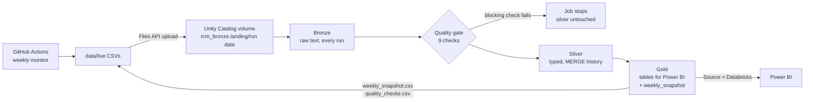

# Databricks lakehouse (v4)

The weekly monitor writes CSV files. v4 adds a Databricks lakehouse after it, so every run is kept, checked and
queryable, and the report can show the trend across weeks, which the CSV files alone could not.

## Layers

| Layer | Tables | What happens |
|---|---|---|
| **Bronze** `rcm_bronze` | `changes`, `change_topics`, `change_audiences`, `dim_date`, `dashboard_changes`, `change_effort`, `capacity_monthly`, `run_log` | Each run's CSV rows exactly as written, all text, tagged `_run_date` and `_loaded_at`. Delete-then-insert per run date, so re-running a date replaces it. |
| **Quality gate** | `rcm_silver.quality_checks` | 9 checks on this run's bronze rows. Blocking: id present, id unique, published is a date, every change is costed. Warnings: impact value, deadline before published, orphan topics, negative hours, no source checked. A failed blocking check stops the job before silver changes. |
| **Silver** `rcm_silver` | `changes`, `dashboard_history`, `run_log` | `changes` is a `MERGE`: new ids get `first_seen_run`, existing ones are updated, ids that leave the feed are kept with `is_current = false`. `dashboard_history` keeps the costed view of every run. `run_log` adds only source checks not loaded before. |
| **Gold** `rcm_gold` | the same tables and columns as the CSVs the report reads, typed, plus `weekly_snapshot` and `quality_checks` | `weekly_snapshot` holds one row per run with the front-page numbers (changes on file, new, needs action, past target, cost, backlog hours, peak month load, sources OK). |

The SQL is in [`lakehouse/sql/`](../lakehouse/sql/), written for Databricks SQL. [`lakehouse/run.py`](../lakehouse/run.py)
uploads the files (Files API) and runs the statements on a SQL warehouse (Statement Execution API): no notebooks or
clusters to manage, and nothing to install on Databricks.

## How it is tested without a Databricks account

`python -m lakehouse.run --source data/live --local some/workspace.duckdb` runs the same SQL files on DuckDB: each
statement is parsed as Databricks SQL and translated with sqlglot. `tests/test_lakehouse.py` uses this to check that
every statement parses as Databricks SQL, that gold matches the CSVs, that re-running a date does not duplicate rows,
that the MERGE keeps `first_seen_run` and flags dropped changes, and that a duplicate id stops the load before silver.

The sample data has no history, so `python -m lakehouse.backfill` replays the synthetic year week by week through the
same pipeline (49 Monday runs plus the final as-of date) to build `bi_export/weekly_snapshot.csv`. One stated
simplification: a change whose final status is Actioned counts as actioned 30 days after it was published.

## Set it up (about 15 minutes, free)

1. **Create a Databricks Free Edition account** at databricks.com (search "Databricks Free Edition"). Use a personal
   email. Free Edition has serverless compute only and one small SQL warehouse, which is all this needs.
2. **Find the warehouse:** SQL Warehouses → *Serverless Starter Warehouse* → *Connection details*. Note the
   **Server hostname** (e.g. `dbc-1234abcd-5678.cloud.databricks.com`), the **HTTP path**
   (`/sql/1.0/warehouses/<id>`) and the **warehouse ID** (the last part of the HTTP path).
3. **Create a token:** your profile (top right) → *Settings* → *Developer* → *Access tokens* → *Generate new token*
   (e.g. 90 days). Copy it once; it is not shown again.
4. **Add three repository secrets** on GitHub: repo → *Settings* → *Secrets and variables* → *Actions* →
   *New repository secret*: `DATABRICKS_HOST` (hostname), `DATABRICKS_TOKEN` (token), `DATABRICKS_WAREHOUSE_ID` (id).
   Never paste the token in an issue, a commit or a chat.
5. **First load:** *Actions* → *Lakehouse load* → *Run workflow*. It loads what is in `data/live`, then commits
   `weekly_snapshot.csv` and `quality_checks.csv`. From then on the Monday monitor loads every run by itself.
6. **Check it:** in Databricks, *Catalog* → `workspace` → `rcm_gold` → `weekly_snapshot`, or run
   `SELECT * FROM workspace.rcm_gold.weekly_snapshot ORDER BY run_date`.

## Point Power BI at the lakehouse

The report reads the CSVs by default (`Source = GitHub CSV`), so it works for anyone. To read the gold tables instead:
Power BI Desktop → *Transform data* → *Edit parameters*: `Source = Databricks`, `DatabricksHost` and
`DatabricksHttpPath` from step 2, `DatabricksCatalog = workspace` → *Apply*. Sign in when asked with
*Personal Access Token* and the token from step 3. The table and column names are the same in both sources.

## Limits and what I would change at scale

* Free Edition: one 2X-Small warehouse, a daily usage quota, no service-level agreement; a heavier load would need a
  paid workspace. Outbound internet from Free Edition is restricted, which is why GitHub Actions pushes the files in
  rather than Databricks fetching them.
* The token lives in GitHub secrets. At work I would use a service principal with OAuth (machine-to-machine) and
  grant it only `USE SCHEMA` / `MODIFY` on the three schemas.
* Bronze is loaded with `read_files` per run; with many files a day, Auto Loader or Lakeflow pipelines would replace
  the delete-then-insert.
* History starts at the first Databricks load; older weekly runs are only in Git history.
