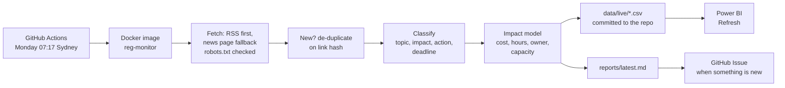

# Live monitor: from agency website to report, every morning

The synthetic dataset shows the method. The live monitor runs the same classifier and impact model on **real
announcements**, every day, without anyone opening a browser.

| Step | Tech | Where |
|---|---|---|
| Schedule and orchestration | GitHub Actions (weekly cron + manual run) | `.github/workflows/monitor.yml` |
| Packaging | Docker (`python:3.12-slim`, non-root) | `Dockerfile` |
| Fetching | `requests`, `feedparser`, `BeautifulSoup`, `urllib.robotparser` | `monitor/fetch.py`, `monitor/sources.py` |
| Classification and costing | Keyword rules, rule-based impact model | `classifier.py`, `impact_model.py` |
| Storage | CSV in Git: every run is versioned and diffable | `data/live/` |
| Alerting | GitHub Issue with the report as its body (GitHub emails the owner) | `reports/latest.md` |
| Dashboard | Power BI, reading the CSVs from GitHub over HTTPS | `powerbi/` |

## Files written each run

| File | What it holds |
|---|---|
| `changes.csv`, `change_topics.csv`, `change_audiences.csv` | Every relevant change seen so far, same schema as `bi_export/` |
| `change_impact.csv`, `change_effort.csv`, `capacity_monthly.csv`, `dashboard_changes.csv` | Impact model output |
| `seen.csv` | Every item ever fetched (relevant or not), so nothing is flagged twice |
| `fetched_latest.csv` | Audit: everything the last run fetched, with its tags |
| `run_log.csv` | One row per source per run: ok, failed or skipped, and why |

The first run is a **baseline**: it loads what is already published and flags nothing, so the first issue is not 50
"new" items.

## What works where (tested 20 Nov 2026)

| Source | From GitHub's cloud runners | From a desktop |
|---|---|---|
| Treasury consultations | Works (10 open consultations fetched) | Works |
| AUSTRAC, Fair Work | Connection times out | Expected to work |
| ATO, OAIC | 403 Forbidden | Expected to work |

Many government sites refuse data-centre traffic. The monitor **does not work around that** (no fake browser
headers, no proxies, no scraping of search engines whose robots.txt forbids it); a failing source is logged and the
run carries on. For full coverage, run the same Docker image from your own computer with `run_local.ps1`, then commit
`data/live` and `reports`.

## Honest limits

- Listing pages change layout; when a source's link pattern stops matching, the run log says "no article links
  matched" and the pattern in `sources.py` needs updating.
- Dates come from the feed or the page; when a page shows none, the first-seen date is used.
- Tags and costs are rule-based estimates, not legal advice.
